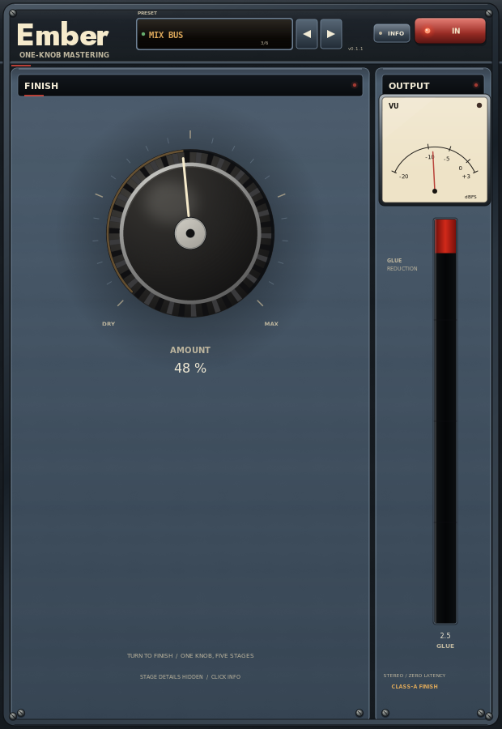

# Ember

[](https://github.com/tylorismusic-commits/ember/actions/workflows/build.yml)

**Version 0.1.1** · [GitHub](https://github.com/tylorismusic-commits/ember) · GPL-3.0-or-later

**Ember** is a free, open-source LV2/CLAP mastering finish for Linux: a single
**Amount** knob that drives a complete mix-bus chain under the hood. Turn it up
and the plugin brings in low-end weight, a gentle upper-mid lift, air, glue
compression, and subtle harmonic sheen at different points in the travel. It is
the third plugin in the Hearth family and shares the same slate-blue, cream, and
red hardware language.



Ember is an original implementation, not an emulation or a copy of any specific
product. It is not affiliated with or endorsed by Waves, Greg Wells, or any
other manufacturer. The design goal is the workflow of a one-knob mix-finishing
processor: musical, quick, and hard to make sound bad.

## Features

- **One control** — **Amount** moves from a genuinely dry path to a complete
  finished-mix chain. The stages enter at different points in the travel, so
  the first part of the knob is subtle tone and the last part is density and
  glue.
- **Gentle mastering EQ** — a low shelf around 90–110 Hz for weight, a broad
  presence bell around 2.6–3.6 kHz, and an air shelf around 10.5–13.5 kHz.
  All bands are mathematically transparent at 0 dB.
- **Glue compression** — stereo-linked, soft-knee, 100 Hz side-chain high-pass,
  programme-dependent release, and automatic makeup that follows the actual
  gain reduction instead of a fixed volume jump.
- **Harmonic finish** — first-order ADAA asymmetric `tanh`, applied to a
  band-limited copy so the dry top end stays open. The stage adds a subtle
  second/third harmonic density rather than a fuzzy distortion.
- **Automatic level stage** — a small finishing lift follows the glue while the
  compressor's auto makeup keeps the loudness musical instead of simply louder.
- **Hidden output protection** — a soft clipper with a +0.2 dBFS ceiling.
  Below the knee it is linear, so normal programme material is untouched.
- **Master bypass** — click-free crossfade, and the dry path is truly clean.
- **Zero latency** — no oversampling, no lookahead, no latency reported to the
  host.
- **Preset bar** — six starting points, applied directly through the UI so they
  work even in hosts that ignore `.ttl` presets. The same six are also provided
  as LV2 preset resources.
- **Native X11/Cairo UI** — the family chassis, original knob artwork,
  brushed-metal texture, Jost ExtraBold wordmark, glass VU, glue-reduction
  meter, and an optional five-stage "under the hood" detail panel. The
  detail panel is hidden by default; click **INFO** in the header to reveal
  it. The UI is resizable and scales from its 620×900 logical layout.
- **LV2 and CLAP builds** — CLAP includes `clap.gain-adjustment-metering` so
  REAPER and other CLAP hosts can show glue gain reduction on their track
  meters. The CLAP build also feeds the plugin's own VU and GR meters, so the
  UI behaves exactly like the LV2 build.

## Signal flow

```
input ──▶ low shelf ──▶ presence bell ──▶ air shelf
      ──▶ glue compressor ──▶ harmonic stage ──▶ finishing level
      ──▶ +0.2 dBFS soft clipper ──▶ master bypass crossfade ──▶ output
```

The chain is deliberately ordered like a finishing chain: shape first, then
glue, then harmonic density, then catch the peaks.

## The Amount map

The exact values move with the knob, so the processor behaves like several
different settings rather than one fixed preset:

| Stage | Enters around | At maximum |
| --- | --- | --- |
| Low shelf | immediately | about +3.2 dB, corner 90 Hz |
| Presence bell | 4 % | about +2.8 dB, 3.6 kHz, Q 0.8 |
| Glue compressor | 6 % | about 4:1, 10 ms attack, 210 ms release |
| Harmonics | 18 % | drive 2.35, parallel blend 55 % |
| Air shelf | 32 % | about +2.2 dB, corner 13.5 kHz |

At 0 % the plugin is a transparent dry path. Around 40–55 % it is an everyday
mix-bus finish; higher settings are deliberately more dense and push the glue
and harmonics harder.

## Build

Dependencies on Debian/Ubuntu:

```sh
sudo apt install build-essential cmake pkg-config \
  lv2-dev libcairo2-dev libx11-dev libfreetype6-dev \
  liblilv-dev libxtst-dev xvfb
```

Configure, build, test, and install:

```sh
cmake -S . -B build -DCMAKE_BUILD_TYPE=Release
cmake --build build -j2
ctest --test-dir build --output-on-failure
cmake --install build
```

The default install prefix is `/usr/local`, so the bundles land in
`/usr/local/lib/lv2/ember.lv2` and `/usr/local/lib/clap/Ember.clap`. To install
into your user folders:

```sh
cmake -S . -B build -DCMAKE_BUILD_TYPE=Release \
  -DCMAKE_INSTALL_PREFIX="$HOME/.local"
cmake --build build -j2
cmake --install build
```

The LV2 bundle contains:

```
ember.lv2/
  ember.so
  emberUI.so
  ember.ttl
  manifest.ttl
  presets.ttl
  knob.png
  metal.png
  Jost-ExtraBold.ttf
  OFL.txt
```

The CLAP build also ships `Ember.resources/` with the UI module and artwork.

## Using it

After installing, rescan plugins in your host and look for **Ember** under the
effect/plugin list.

- **REAPER** — open *Options > Preferences > Plug-ins > LV2* (or CLAP), click
  **Re-scan**, then insert **LV2: Ember** or **CLAP: Ember**.
- **Ardour** — add the LV2 plugin from the processor box. The Ardour inline
  display shows glue gain reduction in the mixer strip.
- **Carla** — add the LV2 plugin and open its UI.

Ember is stereo. Mono tracks are usually fanned to both inputs by the host, so
it also works on mono groups and buses.

For a traditional mastering chain, put Ember before your limiter of choice. It
is a finish, not a brick-wall limiter.

## Presets

Use the `<` and `>` buttons next to the LCD, or click the LCD itself. An asterisk
in the display means the preset has been edited.

| Preset | Amount | Intent |
| --- | --- | --- |
| **Touch of Glow** | 18 % | A little weight and presence with almost no compression |
| **Vocal Bus** | 35 % | Presence-led finish for a vocal bus or backing stack |
| **Mix Bus Finish** | 48 % | The everyday broad, glued, finished mix-bus setting |
| **Drum Bus Glue** | 58 % | More compression and harmonic density for drums |
| **Mastering** | 72 % | A confident master-bus finish before the limiter |
| **Broken Ember** | 100 % | Everything at once, deliberately overdone |

## Controls

| Control | Range | Notes |
| --- | --- | --- |
| **Amount** | 0 … 100 % | The whole finish. 0 % is dry. |
| **IN / BYPASS** | On / Off | Master bypass, clean dry path |
| **VU** | −20 … +3 dBFS | Smoothed peak output level |
| **GLUE** | 0 … 30 dB | Glue gain reduction, shown as a vertical meter |

## Testing

The build includes three tests:

- **DSP** — neutral amount 0, low/presence/air response, glue gain reduction,
  harmonic generation, bypass, hidden clipper, extreme settings, and multiple
  sample rates.
- **Host** — loads the built bundle with lilv, checks ports, UI and presets,
  verifies the inline display, runs audio, and checks transparency, processing,
  and bypass.
- **UI** — embeds the X11 UI under Xvfb, loads a preset, turns the big knob,
  clicks bypass, and captures a screenshot.

## Credits

- The Ember wordmark uses **Jost ExtraBold** (SIL Open Font License 1.1), the
  same geometric sans as the rest of the Hearth family. The license is in
  `assets/fonts/OFL.txt`.
- The knob artwork is original, generated by `assets/make_knob.py`, and is
  included in the GPL-3.0-or-later source.
- The brushed-metal texture is generated by `assets/make_metal.py`.

## License

Ember is free software: you can redistribute it and/or modify it under the
terms of the **GNU General Public License, version 3 or later**. See
[LICENSE](LICENSE).

The Jost font is licensed under the SIL Open Font License 1.1; its license is
included as `assets/fonts/OFL.txt`.
